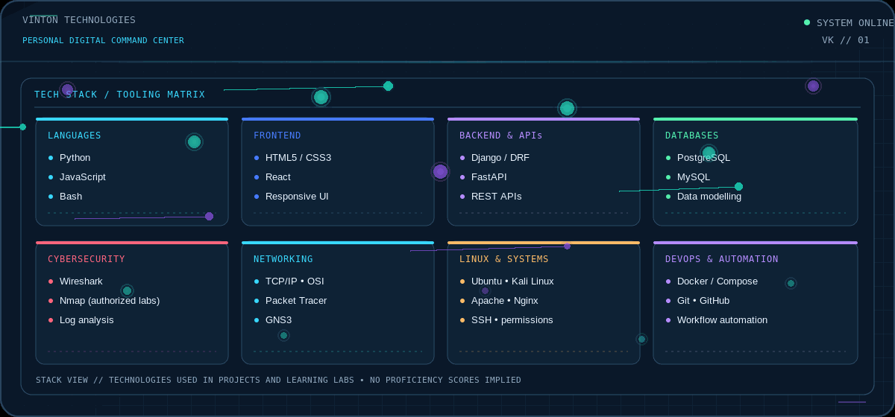
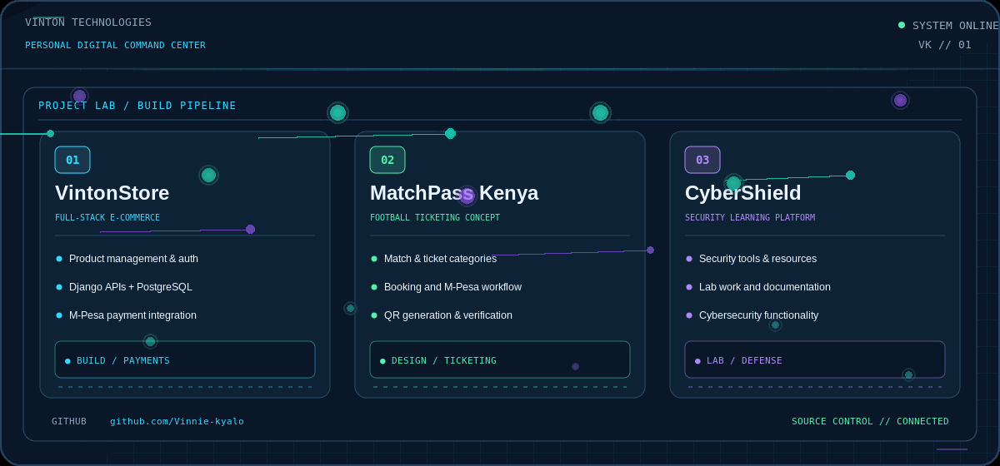
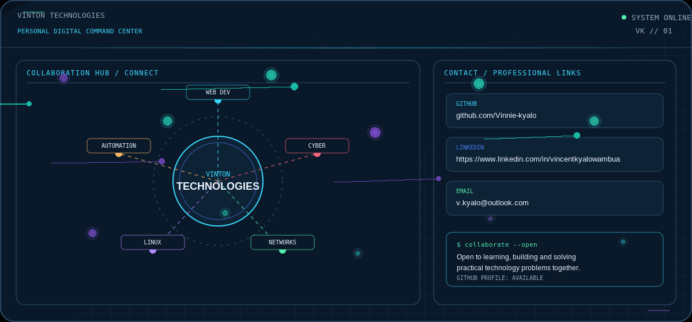

# Vincent Kyalo
> Animated GIFs are used for reliable animation on GitHub. Original SVG source artwork is also included in `assets/`.

**Full-Stack Developer · Cybersecurity Enthusiast · Network Engineer · Linux & Systems Administrator**

## Profile command center

## Technical skills and tools

I work across software development, networking, Linux systems and cybersecurity learning labs. The technologies shown reflect my project and learning interests; they are not proficiency rankings or claims of expert-level mastery.

## Featured projects

- **VintonStore** — Full-stack e-commerce application involving product management, authentication, backend APIs, PostgreSQL and M-Pesa payment integration.
- **MatchPass Kenya** — Football ticketing platform concept involving ticket categories, booking workflows, M-Pesa payments, QR-code generation and ticket verification.
- **CyberShield Security Platform** — Cybersecurity-focused project for showcasing tools, learning resources, lab work and security-related functionality.

## Areas of interest

- **Cybersecurity:** SOC fundamentals, blue-team monitoring, log analysis, Wireshark, Nmap in authorized labs, Linux hardening and digital forensics learning.
- **Full-stack development:** React, JavaScript, Python, Django REST Framework, FastAPI, REST APIs, PostgreSQL and MySQL.
- **Networking:** TCP/IP, OSI, IP addressing, DNS, DHCP, routing, switching, Packet Tracer, GNS3 and traffic analysis.
- **Linux and systems:** Ubuntu, Kali Linux, Bash, permissions, SSH, services, logs, Apache, Nginx, Docker and Docker Compose.
- **Programming and automation:** Python, JavaScript, Bash, Git, API integration and workflow automation.

## Contact and collaboration

- **GitHub:** [Vinnie-kyalo](https://github.com/Vinnie-kyalo)
- **LinkedIn:** Add your LinkedIn profile URL.
- **Email:** Add your preferred professional email address.

I'm interested in building useful software, strengthening security fundamentals, documenting lab work and collaborating on practical technology projects.
